  

Software-Entwickler mit Schwerpunkt auf Web-Anwendungen und Automatisierung. Ich entwickle eigene Produkte von der ersten Idee bis zum Livegang – mit nachvollziehbarem Code, klarer Struktur und sauberer Versionierung.

&nbsp;

### Technologien

<picture>
  <source media="(prefers-color-scheme: dark)" srcset="https://skillicons.dev/icons?i=py,lua,js,ts,nextjs,react,html,css,git,github,vscode,bash&theme=dark&perline=12">
  
</picture>

&nbsp;

### Projekte

**[csbuddy.app](https://csbuddy.app)** – Eigenes Webprojekt in aktiver Entwicklung

&nbsp;

### Aktuell

Systemdesign · Rust · Künstliche Intelligenz

&nbsp;

### Kontakt

[GitHub](https://github.com/28niels) · [csbuddy.app](https://csbuddy.app)
