  

## Über mich

Software-Entwickler mit Schwerpunkt auf Web-Anwendungen und Automatisierung. Ich befinde mich in einer kontinuierlichen Lernphase und setze mein Wissen gezielt in eigenen Projekten um – mit Fokus auf nachvollziehbaren Code, klare Strukturen und saubere Versionierung.

## Projekte

**[csbuddy.app](https://csbuddy.app)**
Eigenes Webprojekt, das ich eigenverantwortlich plane, entwickle und fortlaufend weiterentwickle.

## Kontakt

[GitHub](https://github.com/28niels) · [csbuddy.app](https://csbuddy.app)
