  

  
  
  

 

## Über mich

Ich bin Software-Entwickler mit Schwerpunkt auf Web-Anwendungen und Automatisierung. Ich entwickle eigene Produkte von der ersten Idee bis zum Livegang und lege dabei Wert auf nachvollziehbaren Code, klare Strukturen und eine saubere Versionierung.

Aktuell arbeite ich an [csbuddy.app](https://csbuddy.app) und vertiefe parallel mein Wissen in Systemdesign, Rust und KI.

## Technologien

<table>
  <tr>
    <td width="130"><b>Sprachen</b></td>
    <td>
      <picture>
        <source media="(prefers-color-scheme: dark)" srcset="https://skillicons.dev/icons?i=py,lua,js,ts&theme=dark">
        
      </picture>
    </td>
  </tr>
  <tr>
    <td><b>Web</b></td>
    <td>
      <picture>
        <source media="(prefers-color-scheme: dark)" srcset="https://skillicons.dev/icons?i=nextjs,react,html,css&theme=dark">
        
      </picture>
    </td>
  </tr>
  <tr>
    <td><b>Werkzeuge</b></td>
    <td>
      <picture>
        <source media="(prefers-color-scheme: dark)" srcset="https://skillicons.dev/icons?i=git,github,vscode,bash&theme=dark">
        
      </picture>
    </td>
  </tr>
</table>

## Schwerpunkte

| | |
| :-- | :-- |
| **Web-Entwicklung** | Moderne Web-Anwendungen mit Next.js, React und TypeScript |
| **Automatisierung** | Skripte und Werkzeuge mit Python und Lua, die wiederkehrende Abläufe vereinfachen |
| **Produktentwicklung** | Eigenverantwortliche Umsetzung von der Idee bis zum Livegang |
| **Qualität** | Lesbarer Code, klare Struktur und nachvollziehbare Commits mit Git |

## Projekte

| Projekt | Beschreibung |
| :-- | :-- |
| [**csbuddy.app**](https://csbuddy.app) | Eigenes Webprojekt in aktiver Entwicklung |

Weitere Repositories finden sich in den angepinnten Projekten oberhalb.

## Weiterentwicklung

Systemdesign · Rust · Künstliche Intelligenz

## Kontakt

  
  

