  

## Über mich

Ich baue Webseiten und Tools, meistens mit Next.js, Python und Lua. Ich lerne noch viel dazu, deshalb arbeite ich gern an echten Projekten statt nur an Übungen. Hier auf GitHub landet, woran ich gerade sitze.

## Wie ich arbeite

Ich nutze auch KI-Tools, zum Beispiel zum Nachschlagen. Was ich daraus übernehme, lese und teste ich vorher.

## Projekte

**[csbuddy.app](https://csbuddy.app)**

**[re-tec24.com](https://re-tec24.com)**

## Kontakt

[GitHub](https://github.com/28niels)
